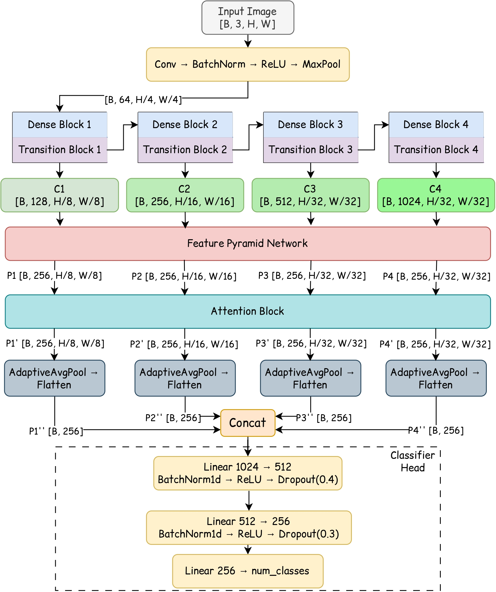

# ICISS2026-BreastUltrasound
Official code repository for our ICISS 2026 research on breast ultrasound image classification using DenseNet121, Feature Pyramid Network (FPN), and Adaptive SE-CBAM Hybrid Attention. Includes model implementation, experimental configurations, and evaluation code.

**Title:** Dual-Attention and Feature Pyramid Network-Enhanced Model for Ultrasound Breast Cancer Classification

**Author:** Britika Khati*, Subhajit Sardar*, Ram Sarkar
*(\* equal contribution)*

**Affiliation:** Department of Computer Science and Engineering, Jadavpur University, India

---

## **Prerequisites**

To run this code successfully, the following software and libraries are required. The implementation is developed using Python and PyTorch.

### **1. Software Requirements**

- **Python:** Python3
- **Operating System:** Linux / Windows / macOS
- **Jupyter Notebook:** Required to execute the `.ipynb` files

### **2. Hardware Requirements**

- **GPU (Recommended):** NVIDIA GPU with CUDA support for faster training
- **CPU:** Supported, but training time will be significantly longer
- **RAM:** Minimum 8 GB recommended
- **Experimental Hardware:** NVIDIA Tesla P100 GPU

### **3. Required Python Libraries**

The following Python libraries are required:

- **PyTorch** (`torch`)
- **Torchvision**
- **NumPy**
- **Matplotlib**
- **scikit-learn**
- **Pandas**
- **tqdm**

Install the required dependencies using:

```bash
pip install torch torchvision numpy matplotlib scikit-learn pandas tqdm
```

**Task:** Breast ultrasound image classification

**Key Idea:** Hierarchical feature extraction, multiscale feature fusion, and adaptive hybrid attention for breast ultrasound classification.

---

## **Overview**

Breast ultrasound imaging is widely used for examining breast abnormalities. However, automated classification of ultrasound images remains challenging due to variations in lesion appearance, image quality, tissue characteristics, and subtle morphological patterns.

Deep learning approaches have demonstrated considerable potential for automated medical image classification. Nevertheless, effectively combining hierarchical representations, multiscale information, and attention-based feature refinement remains an important research challenge.

This work proposes a deep learning framework that integrates a pretrained DenseNet121 backbone, a Feature Pyramid Network (FPN), and an Dual-Adaptive Attention mechanism for breast ultrasound image classification.

The proposed framework aims to capture complementary information from different feature levels while emphasizing discriminative channel and spatial representations.

---

## **What This Work Proposes**

We introduce a feature pyramid-guided dual-attention framework that:

- Combines **DenseNet121** for hierarchical feature extraction.
- Integrates multilevel features through a **Feature Pyramid Network (FPN)**.
- Incorporates **Squeeze-and-Excitation (SE)** and **Convolutional Block Attention Module (CBAM)**.
- Introduces **Dual-Adaptive Attention** for learnable attention integration.
- Employs multilevel feature aggregation for final classification.
- Evaluates performance on binary and multiclass breast ultrasound classification tasks.

---

## **Key Contributions**

### **DenseNet121-Based Hierarchical Feature Extraction**

DenseNet121 is employed as the backbone network to extract hierarchical feature representations from breast ultrasound images.

Its dense connectivity facilitates feature reuse and supports the extraction of complementary representations across multiple network stages.

### **Multiscale Feature Fusion through Feature Pyramid Network**

The proposed framework integrates a Feature Pyramid Network to combine features from different hierarchical levels.

The FPN enables:

- Top-down semantic information propagation.
- Multilevel feature integration.
- Preservation of fine-grained spatial information.
- Improved representation of ultrasound lesions at different scales.

### **Dual-Attention Feature Refinement**

The framework incorporates two complementary attention mechanisms:

- **Squeeze-and-Excitation (SE):** Emphasizes informative channel responses.
- **Convolutional Block Attention Module (CBAM):** Refines feature representations through channel and spatial attention.

These mechanisms help the network focus on discriminative information within the extracted feature maps.

### **Dual-Adaptive Attention**

The proposed AHAF mechanism combines the outputs of SE and CBAM through learnable fusion weights.

This enables adaptive integration of complementary attention representations rather than relying exclusively on a single attention mechanism.

### **Evaluation on Two Breast Ultrasound Datasets**

The proposed framework is evaluated on:

- BUS-BRA for binary classification.
- BUS-UCLM for three-class classification.

The experiments investigate the effectiveness of the proposed framework across different classification settings.

---

## **Architecture**

The proposed DenseFPN-AHAF architecture consists of the following major components:

1. DenseNet121 backbone
2. Hierarchical feature extraction
3. Feature Pyramid Network
4. Dual-Attention Module
5. Dual-Adaptive Attention
6. Feature aggregation
7. Fully connected classification head

**Figure:** Overall architecture of the proposed framework.



---

## **Proposed Framework Mechanism**

The proposed framework processes breast ultrasound images through the following stages:

1. **Hierarchical Feature Extraction:** DenseNet121 extracts multilevel feature representations.
2. **Feature Projection:** Extracted features are projected into a common feature dimension.
3. **Feature Pyramid Construction:** FPN integrates multilevel representations through top-down feature propagation.
4. **Dual-Attention Refinement:** SE and CBAM independently refine the pyramid features.
5. **Adaptive Attention Fusion:** Learnable fusion weights combine the attention-enhanced representations.
6. **Feature Aggregation:** Refined pyramid features are pooled and concatenated.
7. **Classification:** The aggregated representation is passed through the classification head to predict the corresponding breast ultrasound class.

---

## **Datasets Used**

The proposed framework is evaluated on two breast ultrasound image datasets.

### **1. BUS-BRA**

BUS-BRA is utilized for binary breast ultrasound image classification.

**Classification Classes:**

- Benign
- Malignant

**Classification Task:** Binary classification.

**Dataset Distribution:**

| Class | Number of Images |
|---|---:|
| Benign | 1,268 |
| Malignant | 607 |
| **Total** | **1,875** |

**Dataset Split:**

| Subset | Benign | Malignant | Total |
|---|---:|---:|---:|
| Training | 756 | 368 | 1,124 |
| Validation | 195 | 87 | 282 |
| Testing | 317 | 152 | 469 |

The dataset is divided into training, validation, and testing subsets using stratified sampling.

### **2. BUS-UCLM**

BUS-UCLM is utilized for three-class breast ultrasound image classification.

**Classification Classes:**

- Normal
- Benign
- Malignant

**Classification Task:** Three-class classification.

**Dataset Distribution:**

| Class | Number of Images |
|---|---:|
| Normal | 419 |
| Benign | 174 |
| Malignant | 90 |
| **Total** | **683** |

**Dataset Split:**

| Subset | Normal | Benign | Malignant | Total |
|---|---:|---:|---:|---:|
| Training | 335 | 139 | 72 | 546 |
| Validation | 41 | 17 | 10 | 68 |
| Testing | 43 | 18 | 8 | 69 |

The dataset is divided at **image level** into training, validation, and testing subsets using stratified sampling.

**Note:** The datasets are not included in this repository. Users must obtain the datasets from their respective sources and configure the notebook accordingly.

---

## **Experimental Setup**

The proposed framework is implemented using PyTorch.

### **Training Configuration**

| Parameter | Configuration |
|---|---|
| Backbone | DenseNet121 |
| Optimizer | Adam |
| Learning Rate | 0.0001 |
| Weight Decay | 0.0001 |
| Maximum Epochs | 100 |
| Early Stopping | Patience = 20 |
| Learning Rate Scheduler | ReduceLROnPlateau |
| Hardware | NVIDIA Tesla P100 GPU |
| Random Seeds | 42, 123, 999 |

The model is trained using dataset-specific loss functions and class weighting to address class imbalance.

---

## **Results**

The proposed framework achieves the following classification performance.

### **1. BUS-BRA: Binary Classification**

| Metric | Performance |
|---|---:|
| Accuracy | 0.9126 |
| F1-Score | 0.9122 |

### **2. BUS-UCLM: Three-Class Classification**

| Metric | Performance |
|---|---:|
| Accuracy | 0.9130 |
| F1-Score | 0.9130 |

The reported results demonstrate the performance of the proposed model under the evaluated experimental configurations.

---

## **Repository Contents**

This repository contains the final model implementations for both breast ultrasound datasets.

| File | Description |
|---|---|
| `BUS-BRA_FinalModel.ipynb` | Final implementation for binary breast ultrasound classification |
| `BUS-UCLM_FinalModel.ipynb` | Final implementation for three-class breast ultrasound classification |

### **Repository Structure**

```text
ICISS2026-BreastUltrasound/
│
├── README.md
├── BUS-BRA_FinalModel.ipynb
├── BUS-UCLM_FinalModel.ipynb
└── figures/
    └── proposed_model_arch.jpg
```

---

## **How to Run**

### **1. Clone the Repository**

```bash
git clone https://github.com/sardarsubhajit/ICISS2026-BreastUltrasound.git
```

### **2. Install Dependencies**

```bash
pip install torch torchvision numpy matplotlib scikit-learn pandas tqdm
```

### **3. Open the Notebooks**

Open the repository using Jupyter Notebook, JupyterLab, or Google Colab.

### **4. Configure the Datasets**

Download the BUS-BRA and BUS-UCLM datasets from their respective sources.

Update the dataset paths in the corresponding notebooks according to your local environment.

### **5. Execute the Notebooks**

For BUS-BRA:

```text
BUS-BRA_FinalModel.ipynb
```

For BUS-UCLM:

```text
BUS-UCLM_FinalModel.ipynb
```

Run the notebook cells sequentially to:

- Load and preprocess the dataset.
- Initialize the DenseFPN-AHAF model.
- Train the model.
- Evaluate classification performance.
- Generate evaluation results.

---

## **Intended Use**

This repository is intended for academic research and educational purposes.

The proposed framework is a research implementation and is not intended to replace professional medical diagnosis or clinical decision-making.

---

## **Citation**

If you use this implementation in your research, please cite the associated publication:

**Title:** Dual-Attention and Feature Pyramid Network-Enhanced Model for Ultrasound Breast Cancer Classification

**Author:** Britika Khati*, Subhajit Sardar*, Ram Sarkar
*(\* equal contribution)*

*Complete publication details will be added after publication.*

---

## **Acknowledgements**

The authors would like to express their sincere gratitude to **Prof. Ram Sarkar**, Faculty of Department of Computer Science and Engineering, Jadavpur University, for his valuable guidance, encouragement, and support throughout this research work. The authors also acknowledge the **CMATER Laboratory**, Jadavpur University, along with fellow Junior Research Fellows (JRFs), Senior Research Fellows (SRFs), and other research associates for their constructive feedback, insightful discussions, and valuable suggestions that contributed to this work.

