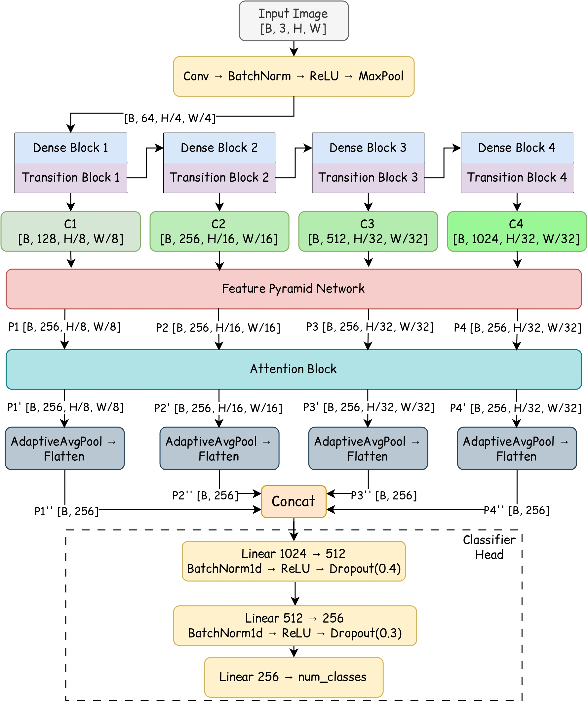

## **Prerequisites**

To run this code successfully, the following software and libraries are required. The implementation is developed using Python and PyTorch.

### **1. Software Requirements**

- **Python:** Python3
- **Operating System:** Linux / Windows / macOS
- **Jupyter Notebook:** Required to execute the `.ipynb` files

### **2. Hardware Requirements**

- **GPU (Recommended):** NVIDIA GPU with CUDA support for faster training
- **CPU:** Supported, but training time will be significantly longer
- **RAM:** Minimum 8 GB recommended
- **Experimental Hardware:** NVIDIA Tesla P100 GPU

### **3. Required Python Libraries**

The following Python libraries are required:

- **PyTorch** (`torch`)
- **Torchvision**
- **NumPy**
- **Matplotlib**
- **scikit-learn**
- **Pandas**
- **tqdm**

Install the required dependencies using:

```bash
pip install torch torchvision numpy matplotlib scikit-learn pandas tqdm
```

**Task:** Breast ultrasound image classification

**Key Idea:** Hierarchical feature extraction, multiscale feature fusion, and adaptive hybrid attention for breast ultrasound classification.

---

## **Overview**

Breast ultrasound imaging is widely used for examining breast abnormalities. However, automated classification of ultrasound images remains challenging due to variations in lesion appearance, image quality, tissue characteristics, and subtle morphological patterns.

Deep learning approaches have demonstrated considerable potential for automated medical image classification. Nevertheless, effectively combining hierarchical representations, multiscale information, and attention-based feature refinement remains an important research challenge.

This work proposes a deep learning framework that integrates a pretrained DenseNet121 backbone, a Feature Pyramid Network (FPN), and an Dual-Adaptive Attention mechanism for breast ultrasound image classification.

The proposed framework aims to capture complementary information from different feature levels while emphasizing discriminative channel and spatial representations.

## **Architecture**

The proposed DenseFPN-AHAF architecture consists of the following major components:

1. DenseNet121 backbone
2. Hierarchical feature extraction
3. Feature Pyramid Network
4. Dual-Attention Module
5. Dual-Adaptive Attention
6. Feature aggregation
7. Fully connected classification head

**Figure:** Overall architecture of the proposed framework.



---

## **Proposed Framework Mechanism**

The proposed framework processes breast ultrasound images through the following stages:

1. **Hierarchical Feature Extraction:** DenseNet121 extracts multilevel feature representations.
2. **Feature Projection:** Extracted features are projected into a common feature dimension.
3. **Feature Pyramid Construction:** FPN integrates multilevel representations through top-down feature propagation.
4. **Dual-Attention Refinement:** SE and CBAM independently refine the pyramid features.
5. **Adaptive Attention Fusion:** Learnable fusion weights combine the attention-enhanced representations.
6. **Feature Aggregation:** Refined pyramid features are pooled and concatenated.
7. **Classification:** The aggregated representation is passed through the classification head to predict the corresponding breast ultrasound class.

---

## **Experimental Setup**

The proposed framework is implemented using PyTorch.

### **Training Configuration**

| Parameter | Configuration |
|---|---|
| Backbone | DenseNet121 |
| Optimizer | Adam |
| Learning Rate | 0.0001 |
| Weight Decay | 0.0001 |
| Maximum Epochs | 100 |
| Early Stopping | Patience = 20 |
| Learning Rate Scheduler | ReduceLROnPlateau |
| Hardware | NVIDIA Tesla P100 GPU |
| Random Seeds | 12, 42, 99, 1111, and 1234 |

The model is trained using dataset-specific loss functions and class weighting to address class imbalance.

---

## Results

The proposed framework was developed progressively by integrating attention mechanisms and multiscale feature extraction components into the DenseNet121 backbone. The performance of each configuration was evaluated on both datasets.

### Progressive Development and Comparative Results

| Configuration | Parameters | BUS-BRA Acc. | BUS-BRA F1 | BUS-UCLM Acc. | BUS-UCLM F1 |
|---|---:|---:|---:|---:|---:|
| DenseNet121 | 7.6M | 0.8699 ± 1.84 | 0.8683 ± 1.87 | 0.8696 ± 2.13 | 0.8707 ± 2.05 |
| DenseNet + SE Attention | 7.7M | 0.8785 ± 1.75 | 0.8798 ± 1.72 | 0.8986 ± 1.85 | 0.8991 ± 1.89 |
| DenseNet + CBAM Attention | 7.7M | 0.8742 ± 1.82 | 0.8741 ± 1.93 | 0.8986 ± 1.97 | 0.8991 ± 2.12 |
| DenseNet + Dual-Attention | 8.0M | 0.8785 ± 1.98 | 0.8793 ± 2.05 | 0.8841 ± 1.64 | 0.8840 ± 1.65 |
| DenseNet + Adaptive Dual Fusion | 8.9M | 0.8849 ± 1.72 | 0.8858 ± 1.94 | 0.8841 ± 1.48 | 0.8879 ± 1.59 |
| DenseNet + FPN | 10.5M | 0.8891 ± 1.68 | 0.8885 ± 1.65 | 0.8696 ± 1.62 | 0.8744 ± 1.76 |
| **Proposed Architecture** | **10.5M** | **0.9040 ± 1.95** | **0.9122 ± 1.98** | **0.9130 ± 1.23** | **0.9130 ± 1.28** |

The results illustrate the progressive development of the proposed framework across both datasets. The final architecture achieves an accuracy of **0.9040** and an F1-score of **0.9122** on BUS-BRA, while achieving an accuracy and F1-score of **0.9130** on BUS-UCLM, with a parameter count of **10.5M**.

Overall, the progressive experiments demonstrate how the integration of feature pyramid learning and hybrid attention contributes to the development of the final architecture, while maintaining a relatively compact model size.

---

## **Intended Use**

This repository is intended for academic research and educational purposes.

The proposed framework is a research implementation and is not intended to replace professional medical diagnosis or clinical decision-making.
